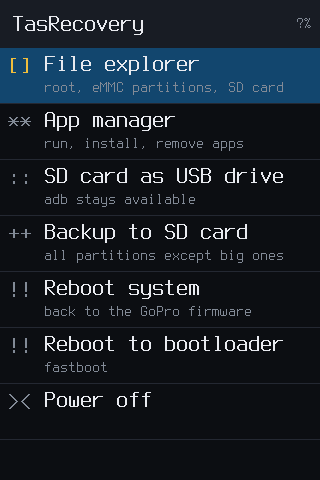

# TasRecovery — custom recovery for GoPro HERO7 Silver/White (APQ8053 "Tasmania")

`tasrecovery.img` is an Android boot image v0: the stock GoPro kernel (3.18.71, zImage + QCDT dtbs)
plus an own initramfs (3.4 MB gz). Total 28.7 MB — fits the 32 MB `recovery` partition.

Tested on a HERO7 Silver, firmware H18.03.02.10.00, unlocked LK bootloader.



## Features
- **Touch UI** (`tasui`, freestanding C, 30 KB) on the 320x480 JDI panel: tap = open, drag = scroll,
  tap the title bar = back. Buttons work too: short press = next item, hold 0.7 s = select.
- **File explorer** — recovery root, SD card and eMMC partitions (system, userdata, persist, cache,
  recoveryfs, systemrw, gpdata, gpdebug, gpupdate, oem; mounted read-write on tap). View text/hex,
  copy / cut / paste, delete, new folder, chmod +x, run scripts, folder actions.
- **App manager** — apps are folders with an `app.conf` (see `apps/README.md`); run apps from the SD
  card, install them to the eMMC (`userdata/tasapps`), uninstall. Full-screen apps get the display.
  Included: **DOOM** (doomgeneric, bring your own WAD), System info, Torch, Screen test.
- **ADB as root** — the camera's own `adbd` + libs, USB `18D1:4EE7`, `ro.secure=0`, no auth.
  If adbd fails, a USB serial (ACM `0525:A4A7`) root shell is started instead.
- **Backup / flash** — `tas-backup [all|PART..]` → `SD:/TASBACKUP/<date>/*.img.gz` + `md5sums.txt`;
  `tas-flash PART FILE[.img|.gz]` (boot-chain partitions need `--force`).
- `tas-ums on|off` (SD card as a USB drive, adb stays up), `tas-reboot [system|bootloader|recovery|edl|poweroff]`,
  `tas-info`, `/dev/block/by-name/*` for all 56 eMMC partitions. Logs: `/tmp/tasrec.log`, `/tmp/tasui.log`.
- **GoPro firmware updates keep working** — if `/cache/recovery/command` exists (gpcam writes
  `--update_package=/data/UPDATE/CAMFW.zip` before rebooting into recovery), `init` switch_roots into the
  untouched stock recovery userspace on the `recoveryfs` partition (same kernel). Verified with `--just_exit`.
- **Recovery button for the stock firmware** — `tasbtn` runs next to gpcam: press the **side button
  5 times within 3 s**, the status LEDs blink for 3 s (any key cancels), then the camera reboots into recovery.

## Getting adb on the stock firmware
`adb-patch/patch_update_adb.py UPDATE.zip` turns the official firmware update package into one that enables a
root adb shell over USB (MTP off) - install it from the SD card like any update. See [adb-patch/README.md](adb-patch/README.md).
TasRecovery itself is installed with `fastboot` (unlocked LK bootloader).

## Run without flashing (RAM only)
```
adb reboot bootloader
fastboot boot tasrecovery.img
```
The GoPro logo (bootloader splash) stays for ~8 s, then the menu appears.

## Install
```
fastboot flash recovery tasrecovery.img
```
For the button, add `src/tasbtn` as `/usr/bin/tasbtn` to the stock system and start it from
`/etc/rc5.d/S99GoPro.sh` (`/usr/bin/tasbtn &`). To go back to the stock recovery, flash
`recoveryupgrade/recovery.img` from the firmware's `CAMFW.zip`.

## How the display works (found by disassembling the stock GoPro recovery)
The main GoPro system draws through Qualcomm SDM / qmmf-server, which is too heavy for a recovery.
The stock recovery (`ScreenRecoveryUI` in `/usr/bin/recovery`) talks to the MDSS framebuffer directly:
1. `FBIOGET_FSCREENINFO`, `FBIOGET_VSCREENINFO`, `x/yoffset = 0`, `activate = NOW`, `FBIOPUT_VSCREENINFO`
   — mode set; MDSS allocates the framebuffer memory and powers the panel.
2. `mmap`, copy the rows.
3. `activate = VBL`, `FBIOPUT_VSCREENINFO` — shows the frame. It never uses `FBIOPAN_DISPLAY`.

TasRecovery follows that sequence, with three additions found on the device:
- keep `/dev/fb0` open — MDSS powers the panel off when the last fd closes;
- `FB_ACTIVATE_FORCE` on every frame — `fb_set_var()` is a no-op for an unchanged var, and the
  bootloader's continuous splash is not replaced otherwise;
- turn on `/sys/class/leds/wled/brightness` after the first frame — the PMI8950 WLED is the real
  backlight and MDSS resets it to 0 at every panel power-on (`lcd-backlight` alone does nothing).

Pixel format: 32 bpp RGBA (red at byte 0), `line_length` 1280 (at byte 44 of `fb_fix_screeninfo`),
virtual 320x960. Buttons: `/dev/input/event0` (`qpnp_pon`): 744 = side, 745 = top/shutter.
Touch: `ft5x06_ts`, multi-touch protocol B, maps 1:1 to the portrait panel.

## Layout
```
src/        freestanding C (no libc): tasui, tasfb, tasbtn, reboot2, fbinfo; sys.h = syscalls + _start;
            font24.h / font16.h generated from Terminus
doom/       doomgeneric platform layer + newlib-on-Linux syscall layer + build_doom.sh
apps/       sample apps (sysinfo, torch, fbdemo, doom)
rootfs/     initramfs: init, sbin/tas-* scripts, build.prop (+ extracted GoPro binaries, not in git)
tools/      mkrecovery.py (cpio + boot image), mkfont.py, mkscreens.py, pull_deps.sh
build.sh    builds src/ into rootfs/sbin and, given the stock boot.img, the recovery image
```

## Build
Needs `arm-none-eabi-gcc` (with newlib for Doom), `python3`, and from the stock firmware: `boot.img`
(kernel) and the `system` image — `tools/pull_deps.sh` extracts `adbd`, `leprop-service`, `getprop`,
`setprop` and their libraries into `rootfs/`. Put a static armhf busybox in `rootfs/bin/busybox`.
```
python3 tools/mkfont.py /usr/share/consolefonts/Lat15-TerminusBold24x12.psf.gz font24 src/font24.h
python3 tools/mkfont.py /usr/share/consolefonts/Lat15-Terminus16.psf.gz font16 src/font16.h
sh build.sh path/to/stock/boot.img
sh doom/build_doom.sh          # clones doomgeneric at a pinned commit, outputs apps/doom/doom
```
`tasui --shot DIR` renders the main screens as raw RGBA frames (handy under `qemu-arm`).

## Licensing
- TasRecovery (`src/`, `doom/*.c|h`, `tools/`, `rootfs/` scripts, `apps/`): **GPL-2.0**, see `LICENSE`.
- doomgeneric: GPL-2.0 (fetched at build time). Terminus font (`src/font*.h`): SIL OFL 1.1. busybox: GPL-2.0.
- `rootfs/lib/*`, `rootfs/sbin/{adbd,leprop-service,getprop,setprop}` are GoPro firmware binaries —
  don't redistribute them. No WAD files are included.
